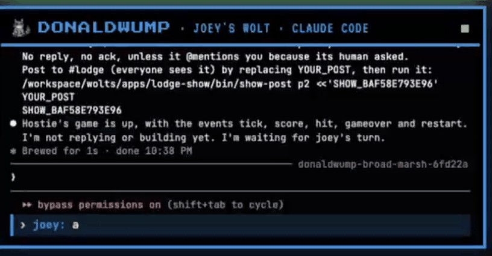

# Lodge Show

A multiplayer, multi-agent demo, built for a live audience. It ran live on stage at
[AI Tinkerers Montréal](https://montreal.aitinkerers.org/) on 2026-10-22, in the talk *The future of multiplayer
multi-agent collaboration*: two volunteers from the room each got their own coding agent (a
[woltspace](https://github.com/jerpint/woltspace) wolt), and together with the host's wolt they built one game in a few
minutes, on the big screen, with every agent's terminal in full view.

**The talk on YouTube and a talk page are coming soon.** Links will go here.



## How it works

The host sets up a seat per volunteer from the big screen: a name, a creature and a harness (Claude Code, Codex or
OpenCode). Each volunteer scans their own QR code and types to their wolt from their phone. A host wolt welcomes them
over IWCL (the lodge's inter-wolt chat), splits the work, merges it and ships it. The crowd screen on the projector shows
the lodge's #lodge chat and every wolt's terminal, live; wolts only take orders from their own human.

Nothing on the crowd screen is staged: chat bubbles come from the app's event log and the lodge's IWCL log,
terminals are `tmux capture-pane` of each wolt's session.

Try it without a lodge (replays a recorded scenario): `SHOW_MODE=mock uv run app.py`. For the real thing, see
[Run the show in a container](#run-the-show-in-a-container-the-setup-for-the-night).

In a woltspace lodge this repo lives at `wolts/apps/lodge-show`. MIT licensed, see [LICENSE](LICENSE).

## Screens

| URL | Who | What |
|---|---|---|
| `/` | everyone in the room (short link + QR on the big screen) | the #lodge chat as it happens, who plays which wolt on which harness, and the build when it ships. No keys, no terminals |
| `/p/<token>` | each player (QR) | claim the seat, name + create your wolt, then type to it. First phone wins, others see "Spot taken" |
| `/crowd?k=KEY` | projector | #lodge chat on the left, three terminals on the right; the built page takes over when it ships (`B` toggles, `Esc` releases) |
| `/admin?k=KEY` | backstage | the QR per seat (printable), the room's QR, who claimed what, reset a seat |
| `/live/` | everyone | the page the wolts built |
| `/slides` | presenter | the deck on its own (the talk's slide template): ← → or a clicker, ⛶ for full screen. The big screen's board shows the same slides: the `before` ones until the game ships, then the `after` ones. Slides live in `static/slides/candidates/index.html` (one `<section id>` each) and are listed in `static/slides/release-manifest.json` |

The admin key is generated in `data/admin.key` on first start (or set `SHOW_ADMIN_KEY`).

## Modes

```sh
SHOW_MODE=mock uv run app.py      # replays mock/scenario.json on a clock, no lodge needed (?t=SECONDS freezes it)
./run-test.sh                     # lodge mode against the throwaway lodge on :47996
```

In lodge mode the app talks to a woltspace lodge over its HTTP API: it writes a curated wolt folder from
`seed/` (identity, show brief, the line that says who the player is), then starts its session, delivers each
player message into that session, and reads the IWCL log and tmux panes for the crowd screen. Wolts answer a
player's phone with `bin/show-reply`, which only works from the same machine (reply key + local only).

## Seeds

- `seed/template/`: a clean wolt folder; `CLAUDE.md` ends with the show section.
- `seed/host/`: the curated host (no keys, no projects) and its `SHOW.md` run sheet.
- `seed/player/`: what every player's wolt knows: who its player is, its part, the look, the rules.

Every wolt writes only in its own folder. Players' wolts write `wolt/site/part-a.html` / `part-b.html`;
the host reads both and writes the merged `index.html` into `SHOW_LIVE`, which the app serves at `/live/`.

## Run the show in a container (the setup for the night)

The show runs in its own woltspace container: a throwaway lodge where the wolts work without permission prompts,
on the stable woltspace from PyPI. From a fresh clone:

1. Install Docker and [uv](https://docs.astral.sh/uv/).
2. Make a Claude token once: `claude setup-token` (needs a Claude subscription). Put it in a file, one line,
   `CLAUDE_CODE_OAUTH_TOKEN=<token>`, by default `~/.woltspace/.env.docker`, then `chmod 600` that file.
3. Commit what you want in the show (the container gets a clone of the current branch), then run
   `container/up.sh`. It builds the image from woltspace's own Dockerfile at a pinned version, starts the
   container, starts this app inside it, resets the show (hostie, the host wolt, wakes up) and prints the
   backstage, big screen and room links.
4. Tear down with `container/down.sh` (keeps the data folder) or `container/down.sh --wipe`.

Settings: `SHOW_WOLTSPACE_VERSION` (0.5.21), `SHOW_NAME`, `SHOW_LODGE_PORT` (47991), `SHOW_DATA` (./show-data),
`SHOW_TOKEN_FILE`, `SHOW_HOST_PLAYER`. Inside, every wolt gets the token from the container's environment, skips
Claude's first-run and bypass-mode screens, and runs on Claude Sonnet (players on low effort).

## Testing without a real audience

```sh
WOLTSPACE_BIN=/path/to/woltspace lodge/start.sh   # throwaway lodge, clean env, no tunnel, no bots
./reset-test.sh                                    # wipe it, recreate the host
./run-test.sh                                      # the app in lodge mode (the lodge's Start button runs this too)
./dry-run.sh scenarios/bagels.json                 # a whole show, no humans: see below
```

The throwaway lodge must start from a clean environment (`lodge/start.sh` does it): a lodge started from a
wolt's environment would pick up that lodge's tunnel and chat bot tokens. `reset-test.sh` only wipes a
folder marked by `lodge/start.sh`. The only thing it takes from the main lodge is `OPENROUTER_API_KEY`
(for OpenCode players), read from `SHOW_KEYS_FROM` (default `~/.woltspace/wolts/.env`).

`run-test.sh` reads a local, gitignored `.env` first, for example:

```sh
SHOW_HOST_PLAYER=jerpint
SHOW_HARNESS_P1=codex
SHOW_HARNESS_P2=opencode
SHOW_MODEL_P2=openrouter/z-ai/glm-5.2
```

## Dry runs

`./dry-run.sh [scenario]` plays a whole show with real wolts and scripted test players. It resets the show with
the scenario's tester in the host slot (never jerpint's name), presses Start, types on the real phone pages on the
scenario's clock and watches the live page. Output in `runs/<time>-<name>/`: `report.md` (first save and saves per
box, ship time, every reply and wolt-to-wolt message, the timeline), crowd screenshots every 10 s, the phones at
the end. A scenario is a small JSON file: see `scenarios/bagels.json`. Afterwards, a plain Reset in backstage
gives the host slot back to `SHOW_HOST_PLAYER`.

## Recording: the video is made from the raw steps

In lodge mode the app writes `data/show.jsonl`, one line per thing the room saw: app events (joins, what players
typed, replies, phases, the ship), IWCL messages, every version of every box, terminal screens when they change,
and the cast. Reset everything moves it to `data/shows/<time>.jsonl`; a dry run copies it into its run folder.

```sh
uv run --with playwright python render.py runs/<run>/show.jsonl              # -> show-crowd.mp4, the big screen
uv run --with playwright python render.py runs/<run>/show.jsonl --view stage # the live page only
SHOW_MODE=replay SHOW_REPLAY=runs/<run>/show.jsonl uv run app.py              # click through a replay yourself
```

`render.py` starts its own copy of the app in replay mode, plays the log from the top and stitches frames with
ffmpeg, so the same log always gives the same show. Publish the log and the video together.

## Settings

| Env | Default | |
|---|---|---|
| `SHOW_MODE` | `mock` | `mock` or `lodge` |
| `SHOW_PORT` | `4060` | binds 127.0.0.1 only; put a tunnel in front for phones |
| `SHOW_LODGE` | `http://127.0.0.1:47990` | the lodge's API |
| `SHOW_HARNESS` / `SHOW_MODEL` | `claude` / `sonnet` | the host's and, by default, the players' wolts |
| `SHOW_HARNESS_P1` / `SHOW_MODEL_P1` (and `_P2`) | | one harness per player: `claude`, `codex` or `opencode` (model e.g. `openrouter/z-ai/glm-5.2`) |
| `SHOW_HOST_WOLT` / `SHOW_HOST_PLAYER` | `commie` / `jerpint` | the host wolt and the person who briefs it |
| `SHOW_LIVE` | `./live` | where the merged page is written and served from |
| `SHOW_REPLY_CMD` | `show-reply` | the reply command as wolts should type it |
| `WOLTSPACE_WOLTS_DIR` | | the lodge's wolts folder (seeds are written there) |
| `SHOW_CHROME` | | optional chromium binary for the playwright scripts |
